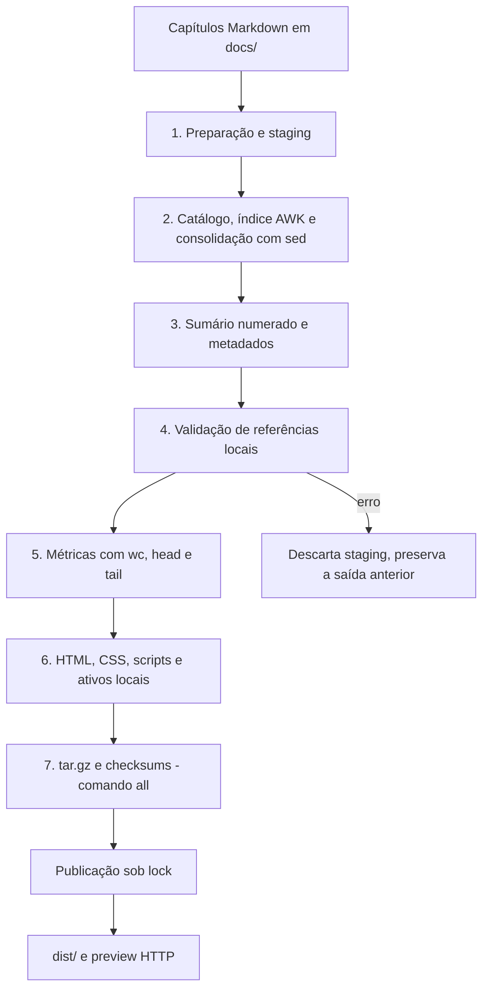

# 02. Arquitetura e Engenharia de Pipeline

## Visão do fluxo

A CLI resolve o diretório do projeto a partir de `catalyst.sh`, carrega os módulos Shell e seleciona a operação pelos argumentos. O processamento lê os fontes sem modificá-los e grava em uma área privada. Só publica uma nova saída depois de concluir as etapas solicitadas.

As sete etapas descrevem o comando `all`. `build` termina após gerar a interface, sem refazer o pacote. O servidor e o relatório acadêmico são operações separadas.

## Etapas de geração

### 1. Preparação

`transaction.sh` adquire `.catalyst/build.lock` com `flock` e cria staging no mesmo filesystem. Quando há publicação anterior, seu conteúdo é copiado para a transação, exceto em `clean`. `init_env` prepara os diretórios e o arquivo de métricas sem truncá-lo.

### 2. Catálogo, índice e consolidação

`parser.sh` descobre capítulos com `find -print0 | sort -zV`, mantém a ordem em uma lista e rejeita uma entrada sem capítulos. Nomes com espaços são aceitos, tabulações e quebras de linha em nomes de capítulos são rejeitadas.

`markdown.awk` faz uma passagem de índice antes da reescrita. Assim, um capítulo pode referenciar títulos de outro que aparece depois. O índice mantém títulos, IDs locais e globais e definições de links de referência. A reescrita converte links entre capítulos para âncoras da publicação e registra ativos e erros. `sanitizer.sh` aplica `sed -e 's/\r$//'` ao resultado, preservando o texto significativo.

### 3. Sumário e metadados

`toc.awk` lê `headings.tsv`, mantém contadores por nível e produz `summary.md` e `headings.json`. A numeração usa a estrutura de títulos, não o prefixo do nome do arquivo. Os IDs são calculados pelo compilador e reutilizados pelo navegador.

### 4. Validação

`validator.sh` procura registros `ERROR` em `links.tsv` com regex estendida e confere os arquivos locais por `realpath`. Referências ausentes, fragmentos inválidos e ativos fora do projeto causam falha antes da publicação. A validação não faz requisições de rede para verificar URLs externas.

### 5. Métricas

`compute_statistics` calcula capítulos, linhas e palavras, registra a data e extrai três linhas iniciais e finais com `head` e `tail`. A saída fica em `metrics/metrics.txt`. Essas contagens descrevem a publicação, a contagem acadêmica de código é obtida separadamente com `cloc`.

### 6. Interface e ativos

`preview.sh` verifica os checksums de `vendor/`, copia CSS, JavaScript e bibliotecas locais e preenche a política de segurança no template HTML. Ativos referenciados são copiados para `assets/files/`, preservando o caminho relativo no projeto. O conteúdo de `images/` também é mantido na área de ativos por compatibilidade.

O navegador busca documento, índices e métricas por HTTP. Marked renderiza Markdown, DOMPurify sanitiza HTML e Mermaid renderiza diagramas em modo estrito. A barra lateral usa os IDs e títulos do índice, com criação de elementos e conteúdo textual controlados.

### 7. Release

`packager.sh` inclui `docs`, `metrics`, `reports`, `index.html`, `ui` e, quando existe, `assets` no tarball. `releases/` não entra no próprio pacote. O módulo aplica permissão simbólica ao arquivo e gera `.sha256`, além de `.md5` por compatibilidade ou `.cksum` quando MD5 não está disponível.

SHA-256 é uma verificação de integridade comparada a uma referência confiável, não é assinatura digital. O pacote ainda não normaliza datas e metadados para builds reproduzíveis byte a byte.

## Responsabilidades dos componentes

- `catalyst.sh`: CLI, etapas, métricas e observação de alterações.
- `scripts/core/cli-options.sh`: seleção de entrada/saída, resolução de caminhos e proteção dos destinos.
- `scripts/core/parser.sh` e `markdown.awk`: catálogo, índice, consolidação e referências.
- `scripts/core/toc.awk`: numeração e exportação do sumário.
- `scripts/core/sanitizer.sh`: normalização CRLF por sed.
- `scripts/core/validator.sh` e `validation-report.awk`: conferência dos ativos e relatório Markdown da última tentativa.
- `scripts/core/preview.sh`: preparação da interface e cópia dos ativos.
- `scripts/core/packager.sh`: tarball, permissões e checksums.
- `scripts/core/transaction.sh`: staging, bloqueios, publicação e recuperação.
- `scripts/core/server.sh`: preview Bash, PID, porta, sinais e ciclo de vida dos dois backends.
- `scripts/core/server-threaded.py`: preview Python concorrente opcional.
- `scripts/core/completion-command.sh` e `scripts/completion.bash`: configuração e definições de autocompletar.
- `scripts/academic-report.sh`: planilha dinâmica, execução do cloc e fontes numerados.
- `scripts/export-report-pdf.py`: exportação opcional do relatório.
- `templates/`: HTML, CSS, JavaScript e política CSP da interface.
- `vendor/`: bundles, licenças, manifesto de versões e hashes.
- `scripts/demo.sh` e `examples/demo/`: demonstração isolada de publicação válida e referências inválidas.
- `scripts/tests/` e `scripts/ci/check.sh`: verificações e integração contínua.

## Contratos dos arquivos gerados

- `docs/full-document.md`: capítulos consolidados com destinos reescritos.
- `docs/summary.md`: sumário hierárquico numerado para consulta textual.
- `docs/headings.tsv`: índice de títulos usado no processamento.
- `docs/headings.json`: títulos, níveis, numeração e IDs consumidos pela interface.
- `docs/chapters.json`: relação de capítulos e âncoras da publicação.
- `docs/links.tsv`: manifesto de referências, ativos e diagnósticos.
- `metrics/metrics.txt`: contagens e amostras da publicação.
- `index.html` e `ui/`: apresentação e bibliotecas locais.
- `assets/files/`: cópias dos arquivos locais referenciados.
- `reports/`: relatório gerado por `report` e PDF gerado por `report --pdf`.
- `releases/`: pacote e arquivos de checksum.

Os caminhos acima são relativos a `dist/`. Os metadados publicados usam caminhos relativos de origem, sem depender de caminhos privados da máquina de desenvolvimento.

## Publicação transacional

### Escritores e leitores

`build.lock` serializa os comandos que produzem saída. O staging é privado, leitores continuam acessando a publicação anterior enquanto o build ocorre. `publish.lock` coordena o commit e as respostas dos servidores. `validate` usa staging para conferir os fontes e descarta o resultado, sem alterar `dist/`.

### Filesystem Linux

O modo automático cria gerações em `.catalyst/generation.*` e substitui o link `dist` por rename. Depois da migração inicial de um diretório legado, a troca do link publica o snapshot inteiro de uma vez. A geração anterior é mantida, mas não há um subcomando de seleção manual de versões.

### Unidades Windows no WSL

Em DrvFS/v9fs, o modo automático mantém `dist/` como diretório legível pelo Windows. O commit copia arquivos sob lock, guarda backup e registra um journal. Falhas tratadas restauram a publicação, após uma queda, o escritor ou preview usa o journal para recuperá-la.

A CLI e os previews cooperam com esse bloqueio. Um leitor externo que ignore `publish.lock` pode observar arquivos de gerações diferentes durante a troca. Para atomicidade do snapshot inteiro, use filesystem Linux nativo.

`CATALYST_PUBLISH_MODE=symlink` ou `directory` seleciona explicitamente o modo. Prefira o automático e não altere a estratégia de uma publicação ativa. Não remova `.catalyst/` enquanto houver processos executando.

## Ciclo de vida do preview

O servidor escuta em `127.0.0.1`. O estado privado por usuário e projeto fica em `${TMPDIR:-/tmp}/catalyst-*`, com PID, porta, backend e log. Antes de sinalizar um processo, o controle confere sua identidade em `/proc`. Uma porta ocupada por outro programa é rejeitada.

O backend Bash usa OpenBSD netcat com listener persistente (`-k`) e processamento sequencial. Conexões do navegador podem aguardar na fila sem depender de recriar o listener entre arquivos. Leituras incompletas têm timeout. O backend `threaded` usa a biblioteca padrão Python, até 32 conexões ativas e timeout de oito segundos.

`serve --restart` preserva porta e backend se não houver novas opções. `serve --stop` envia SIGTERM ao grupo e usa SIGKILL se necessário. Cada resposta resolve a publicação atual sob lock, acompanhando builds novos sem reiniciar. Ambos são previews de desenvolvimento, sem autenticação ou TLS.

## Fronteira de segurança da interface

O build valida os bundles locais. O navegador sanitiza o HTML antes da inserção, atribui os IDs do compilador e substitui imagens remotas por texto alternativo. A CSP restringe scripts, conexões e frames, estilos inline permanecem permitidos para SVGs do Mermaid, enquanto estilos arbitrários do documento são removidos.

Os previews aplicam uma CSP sandbox adicional a arquivos sob `/assets/`. Quem publicar em outro servidor deve configurar cabeçalhos equivalentes: a política do index não protege arquivos HTML/SVG abertos separadamente. Essas medidas não ampliam o parser para toda a especificação CommonMark nem transformam o preview em servidor de produção.

## Contexto de entrada, saída e auditoria

O diretório do motor continua sendo a origem dos módulos, templates, bibliotecas e evidências acadêmicas. A pasta pai de `--docs` define separadamente a raiz dos capítulos e ativos. `--output` define a publicação e seu estado transacional; o catálogo exclui essa saída, o estado oculto e a auditoria para não reprocessar artefatos gerados.

Saídas com nomes diferentes têm locks, staging e gerações independentes, compartilhados com seus previews. O marcador `.catalyst-output` identifica diretórios gerados; ele não é incluído no tarball estático. A publicação padrão preserva compatibilidade com a estrutura anterior.

O compilador registra ocorrências locais válidas, ativos, URLs externas não consultadas e erros em `links.tsv`. O validador completa a conferência canônica e produz a auditoria Markdown por troca atômica de arquivo. A última tentativa fica em `<saida>.validation.md`; só builds aprovados incluem uma cópia em `reports/validation.md`. Dessa forma, registrar um erro não modifica o snapshot válido anterior.
