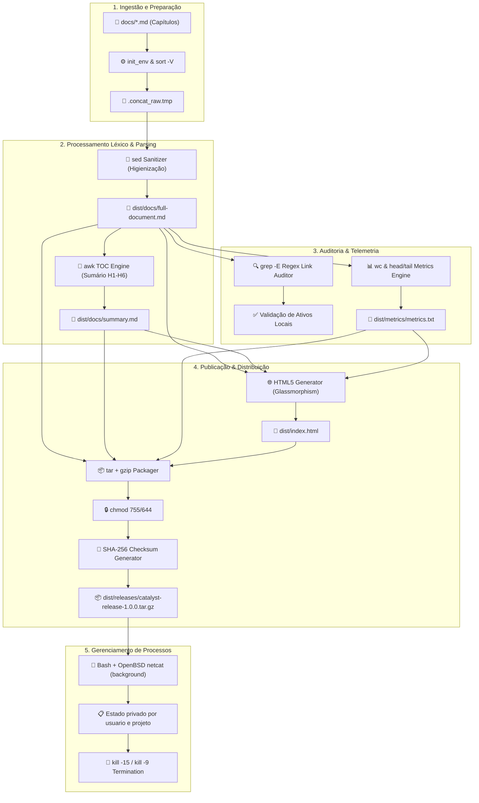

# 02. Arquitetura e Engenharia de Pipeline

## Princípios de Design e Filosofia Unix

O design arquitetural do **Catalyst Shell Engine** fundamenta-se nos princípios canônicos da filosofia Unix formulados por Doug McIlroy e Brian Kernighan:

1. **Faça apenas uma coisa e faça-a bem**: Cada subcomando do motor (`build`, `validate`, `toc`, `sanitize`, `stats`, `pack`, `serve`) encapsula uma etapa autônoma do ciclo de vida da documentação.
2. **Escreva programas para trabalharem juntos**: As saídas de um utilitário fluem naturalmente para a entrada de outro por meio de *pipes* (`|`) e redirecionamentos (`>`, `>>`, `<`).
3. **Trate o texto como a interface universal**: Em vez de binários opacos ou bancos de dados relacionais complexos, toda a informação é armazenada e manipulada como fluxos de texto Markdown puro e relatórios legíveis.

---

## Diagrama de Fluxo de Dados do Pipeline

O pipeline do Catalyst Shell Engine opera em **7 estágios sequenciais**, garantindo validação, higienização e empacotamento dos artefatos:



---

## Detalhamento dos 7 Estágios do Pipeline

### Estágio 1: Preparação do Ambiente (`init_env`)
- Criação garantida do diretório de saída `dist/` com controle de erro (`mkdir -p "$DIST_DIR" || exit 1`).
- Definição de permissões octais estritas (`chmod 755 "$DIST_DIR"`).
- Criação do arquivo de métricas sem truncar resultados de subcomandos anteriores (`touch "$METRICS_FILE"`).

### Estágio 2: Índice e Consolidação (`consolidate_documents`)
- Descobre capítulos recursivamente com `find -print0` e `sort -zV`.
- GNU AWK indexa títulos H1–H6, Setext e definições de referência antes da reescrita.
- Links entre capítulos são convertidos para IDs globais únicos; referências de
  ativos são resolvidas a partir do arquivo de origem e registradas no manifesto.
- O programa sed normaliza CRLF sem alterar a indentação ou os hard breaks.

### Estágio 3: Sumário (`generate_toc`)
- `toc.awk` mantém contadores por nível e utiliza os IDs já calculados pelo índice.
- Gera `summary.md` e `headings.json`, evitando divergência entre CLI e navegador.
- Cercas respeitam seu caractere e comprimento; exemplos de código não viram títulos.

### Estágio 4: Auditoria (`validate_assets_and_links`)
- `grep -E '^ERROR[[:space:]]'` detecta diagnósticos de arquivo, referência ou fragmento.
- Ativos são conferidos por caminho canônico para impedir cópia fora do projeto.
- Qualquer erro interrompe a transação e preserva a publicação anterior.

### Estágio 5: Cálculo Estatístico de Métricas e Integridade (`compute_statistics`)
- Extração de métricas quantitativas de volume utilizando `wc -l` (linhas) e `wc -w` (palavras).
- Amostragem instantânea de abertura e encerramento do compêndio via `head -n 3` e `tail -n 3`.
- Consolidação do relatório estruturado em `dist/metrics/metrics.txt`.

### Estágio 6: Geração de Interface Web Interativa com ChatBot (`generate_html_preview`)
- Criação autônoma do arquivo `dist/index.html` (único arquivo na raiz de distribuição).
- Interface moderna inspirada no sistema de design **GlassHub Quasar** (vidro fosco, tema escuro, variáveis CSS HSL, painel lateral responsivo e renderizador Markdown dinâmico com fallback).
- **Catalyst DocBot (Assistente Virtual Integrado)**: Motor local de recuperação de informação em Vanilla JS; as bibliotecas são distribuídas em `vendor/` e copiadas para `dist/ui/vendor/`, com busca por seções, deep linking, botões de ação e comandos de terminal (`/help`, `/conceitos`, `/stats`, `/benchmark`).

### Estágio 7: Empacotamento e Certificação de Release (`package_release`)
- Compactação e compressão gzip de todos os artefatos gerados (`tar -czf`).
- Atribuição de permissões simbólicas de segurança ao bundle (`chmod u=rw,go=r`).
- Geração automatizada de checksum SHA-256, com MD5 adicional por compatibilidade, salvando a assinatura em `dist/releases/catalyst-release-*.tar.gz.md5`.

---

## Organização de Diretórios e Componentes

```text
CatalystShellEngine/
├── catalyst.sh               # Orquestrador mestre e CLI unificada
├── docs/                     # Fonte primária da documentação técnica dividida em capítulos
│   ├── 00-cover.md           # Capa oficial e metadados institucionais
│   ├── 01-overview.md        # Visão geral, contexto do GlassHub e matriz de capacidades
│   ├── 02-architecture.md    # Engenharia do pipeline, diagrama Mermaid e estágios
│   ├── 03-concepts.md        # Detalhamento exaustivo dos 20 conceitos do enunciado
│   ├── 04-usage-guide.md     # Manual completo de operação da linha de comando
│   ├── 05-benchmarks.md      # Análise de performance vs. GlassHub Catalyst original
│   └── 06-conclusion.md      # Considerações finais, maturidade e roadmap
├── dist/                     # Diretório de distribuição compilado e certificado
│   ├── index.html            # Único arquivo na raiz: Interface web interativa + DocBot
│   ├── docs/                 # Subpasta de compilação textual unificada
│   │   ├── full-document.md  # Documento único consolidado e higienizado
│   │   └── summary.md        # Sumário hierárquico navegável gerado por AWK
│   ├── metrics/              # Subpasta de telemetria estatística
│   │   └── metrics.txt       # Relatório quantitativo de linhas e palavras (wc)
│   ├── reports/              # Subpasta de relatórios acadêmicos oficiais
│   │   └── sigaa-report.md   # Relatório unificado com código numerado para o SIGAA
│   └── releases/             # Subpasta de empacotamento e distribuição
│       ├── catalyst-release-*.tar.gz     # Bundle empacotado para distribuição
│       └── catalyst-release-*.tar.gz.md5 # Checksum MD5 de compatibilidade
├── scripts/                  # Biblioteca modular com componentes especializados
│   ├── core/                 # Módulos isolados de parsing, validação e sanitização
│   └── utils/                # Utilitários de logging colorido e formatação ANSI
└── CEFET_REPORT.md           # Relatório acadêmico oficial com planilha de conformidade
```

O orquestrador carrega os módulos de parser, sanitizer, validator, packager, preview, transação e completion; executa o servidor e o gerador acadêmico como processos externos. O HTML, CSS e JavaScript estão separados em `templates/`. A interface usa uma convenção própria de âncoras, distinta da convenção do GitHub.


## Staging, bloqueios e publicação

Os escritores compartilham `.catalyst/build.lock` e trabalham em diretórios staging
exclusivos. Só o snapshot concluído é publicado. Um segundo lock, `publish.lock`,
coordena o commit com as respostas do preview, sem bloquear a leitura durante o
processamento dos capítulos.

No Linux nativo, um rename troca o link `dist` para a geração concluída. A geração
anterior é mantida, e versões mais antigas são removidas sob o lock. A conversão
inicial de um `dist` legado é coordenada por esse mesmo lock.

No DrvFS do WSL, `dist` permanece um diretório compatível com Windows. Um journal
registra o commit em andamento e permite restaurar o backup após falha ou queda.
Nesse modo a consistência do snapshot depende do leitor respeitar `publish.lock`;
leitores externos podem observar arquivos de versões diferentes durante o commit.

O preview resolve a geração a cada requisição, para acompanhar builds novos sem
reiniciar o processo. `watch` adquire o lock apenas em cada build; não o retém
enquanto aguarda alterações.


## Índice Markdown e fronteira de renderização

`markdown.awk` indexa os capítulos antes de reescrever links, para resolver destinos
que aparecem em arquivos posteriores. IDs locais são mapeados para IDs globais
únicos. Referências são expandidas no escopo do capítulo. `toc.awk` gera o sumário
e `headings.json` a partir dos mesmos registros, sem outro algoritmo de slug no
navegador. `links.tsv` registra erros e os ativos a copiar para a publicação.

A sanitização remove scripts, formulários, eventos, IDs e atributos perigosos do
HTML. O renderizador atribui IDs somente aos títulos marcados por tokens efêmeros
e pelo índice confiável do compilador, evitando colisão com os controles da página.
Diagramas Mermaid usam configuração estrita e passam por sanitização SVG separada.
O servidor concorrente utiliza threads e adquire o mesmo flock por resposta; a
recuperação de journal continua centralizada no módulo de transações.
